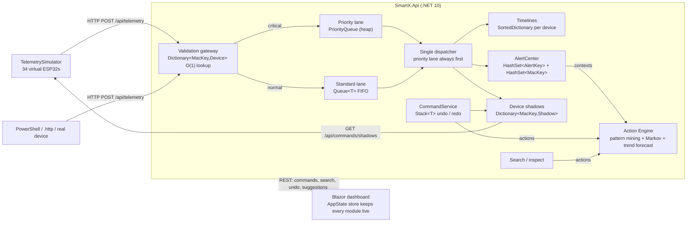

# SmartX: Real Time Processing and Device Management (PoE Part 2)

Student name:Kwanda Zulu
Student number:ST10439005 
SmartX is a simulated IoT mesh for South African hydroponic farms, utility trackers and smart grid sites. It has:

- an **ASP.NET Core Minimal API** backend on .NET 10;
- a **Blazor WebAssembly** dashboard;
- **SignalR**, which pushes live updates from the API to the dashboard.

**Part 1** built the ingestion gateway and the Sensor Pulse Grid. **Part 2** turns it into a real time processing engine:

- **Two lane ingestion queue.** A `Queue<T>` handles normal traffic, and a `PriorityQueue` lets critical alerts skip ahead of it.
- **Device lookups.** A `Dictionary` keyed by MAC address finds any device in O(1).
- **Timelines.** A `SortedDictionary` stores readings in time order for the graphs.
- **Alert de duplication.** `HashSet`s keep alerts and disconnected nodes unique.
- **Undo.** A `Stack<T>` keeps the history of manual override commands.
- **Predictive action engine.** It learns what operators search for and do after an alert, then suggests the next step.

---

## Contents

1. [What is new in Part 2](#1 what-is-new-in-part-2)
2. [Where each rubric requirement lives](#2-where-each-rubric-requirement-lives)
3. [Install on Windows (step by step)](#3-install-on-windows-step-by-step)
4. [Build, test and run](#4-build-test-and-run)
5. [What you should see](#5-what-you-should-see)
6. [How to test the queues, dictionaries, sets, stack and engine](#6-how-to-test-the-queues-dictionaries-sets-stack-and-engine)
7. [Demo script for the video](#7-demo-script-for-the-video)
8. [Run with Docker](#8-run-with-docker)
9. [API reference (Part 2)](#9-api-reference-part-2)
10. [Design rationale](#10-design-rationale)
11. [Troubleshooting](#11-troubleshooting)
12. [References](#12-references)

---

## 1. What is new in Part 2



- **Simulated devices really call the API.** The simulator sends every reading as an HTTP request, like a physical ESP32 would. It goes through the same validation, queues and dispatcher as any other request. Actuators poll their *device shadow* (desired state) and report it back in their telemetry, which confirms each command [8].
- **Commands have physical effects.** Pump A irrigates Sub Zone B and Pump B irrigates Sub Zone A, but only while a manifold valve is open. Pump meters draw power while their pump runs. A dry out triggers a critical moisture alert. The engine then suggests starting Pump A, and once the operator accepts, moisture recovers in the live graph.
- **Navigation keeps state.** Every module is fed from one shared client side store (`AppState`) and one SignalR connection. Switching between the Pulse Grid and the Command Stream is instant. Filters, the selected device, the stream feed, undo history and alert toasts all survive the switch.

## 2. Where each rubric requirement lives

| Rubric item | Implementation | Where |
|---|---|---|
| **Main menu and navigation (30)** | Grouped module menu: Telemetry (Part 1), Commands (Part 2), Mesh (final PoE placeholder route, so nothing breaks). Live badges, alert toasts on every page, an `ErrorBoundary` that isolates a failing view, and one shared state store and SignalR connection so views never reload or lose state. | `Client/Layout/MainLayout.razor`, `Client/Services/AppState.cs`, `Client/Components/LiveComponent.cs`, `Client/Pages/Mesh.razor` |
| **Queue&lt;T&gt; (FIFO telemetry)** | Standard lane of the two lane buffer. Bounded, with load shedding (HTTP 503) when full. | `Core/Streaming/DualLaneQueue.cs`, `Api/Services/IngestPipeline.cs`, `Api/Background/TelemetryDispatcher.cs` |
| **Priority queue (critical alerts bypass)** | `PriorityQueue<T,(severity, sequence)>`, always dequeued first. Readings below 20 % moisture or at/above 4 kW are classified at the door. Burst test proves position #1. | `Core/Streaming/DualLaneQueue.cs`, `Api/Services/AlertCenter.cs` (`ClassifyCritical`), `POST /api/stream/burst` |
| **Stack&lt;T&gt; (undo of manual overrides)** | Undo and redo stacks. Undo reverts bulk commands such as *Close all valves* device by device. Stack is capped at 50. | `Core/Commands/UndoRedoHistory.cs`, `Api/Services/CommandService.cs`, `Client/Components/CommandHistoryPanel.razor` |
| **Dictionary&lt;TKey,TValue&gt; (O(1) device lookup by MAC)** | `Dictionary<MacKey, SensorDevice>`. `MacKey` is the 48 bit address with a SplitMix64 mixed hash, so it has no collisions where a naive hash would have hundreds. There are also category, Sub Zone and word indexes. | `Core/Devices/MacKey.cs`, `Api/Services/DeviceRegistry.cs`, `Core/Benchmarks/LookupBenchmark.cs` |
| **SortedDictionary (timelines)** | One capped `SortedDictionary<TimelineKey,double>` per device and one for the global history. Readings stay in time order even when a priority packet overtakes older ones. A single pass min/max downsampler feeds the graph. | `Core/Timeline/TimelineStore.cs`, `Api/Services/TimelineService.cs`, `Client/Components/TimelineChart.razor` |
| **HashSet&lt;T&gt; (unique errors / disconnected nodes)** | `HashSet<AlertKey>` of active alerts and `HashSet<MacKey>` of disconnected nodes. Offline devices are re reported every second and the set absorbs the duplicates; the dashboard shows the suppressed count. | `Api/Services/AlertCenter.cs`, `Client/Components/AlertBoard.razor` |
| **Search / filter by category or alert state** | Text search (word index plus `HashSet.IntersectWith`), category, live state (Healthy / Spike / Fading / Offline) and "active alerts only". | `Api/Endpoints/StreamEndpoints.cs`, `Client/Components/DeviceFinder.razor` |
| **Manual override commands** | Start/stop pumps, open/close valves, toggle relays, bulk valve commands. Each command shows *Pending* until the device confirms it, then *Confirmed* with the latency. | `Api/Services/CommandService.cs`, `Client/Pages/CommandStream.razor` |
| **Predictive action engine (30)** | Learns *situation → action* rules (support, confidence, lift) and *action → next action* sequences, weighted towards recent behaviour. It ranks the top 5 suggestions with a heap and explains each one. It also forecasts threshold crossings by least squares and flags faulty, flapping, unconfirmed and clustered outage devices. Tracks hit rate and acceptance rate. | `Core/Analytics/PatternMiner.cs`, `Core/Analytics/LinearTrend.cs`, `Api/Services/ActionEngine.cs`, `Api/Seeding/EngineSeeder.cs`, `Client/Components/SuggestionsPanel.razor` |
| **Part 1 still works** | Pulse Grid, devices, uploads, power operators, recursion, diagnostics are all intact and now fed by the same queues. | `Client/Pages/*` |

## 3. Install on Windows (step by step)

You need: the **.NET 10 SDK**, **Git**, an editor, and optionally **Docker Desktop**.

### 3.1 Install the tools

Open **PowerShell** (Start → type `PowerShell`) and run:

```powershell
winget install Microsoft.DotNet.SDK.10
winget install Git.Git
```

Close PowerShell, open a new window, and check:

```powershell
dotnet --list-sdks     # must show a line starting with 10.0.
git --version
```

If `dotnet` is "not recognized", restart the PC.

### 3.2 Pick an editor

| Editor | Install | Notes |
|---|---|---|
| **Visual Studio 2026 Community** | `winget install Microsoft.VisualStudio.Community` | During setup tick **ASP.NET and web development**. Visual Studio 2022 cannot open .NET 10 projects. |
| **JetBrains Rider** | free for students | Opens `SmartX.slnx` directly. |
| **VS Code** | `winget install Microsoft.VisualStudioCode` | Add the **C# Dev Kit** and **REST Client** extensions. |

### 3.3 Optional: Docker Desktop

```powershell
winget install Docker.DockerDesktop
```

Docker Desktop needs WSL2 and will offer to enable it. Restart when asked.

### 3.4 Allow the PowerShell test scripts

The `scripts\*.ps1` helpers are unsigned. Allow local scripts for your user once:

```powershell
Set-ExecutionPolicy -Scope CurrentUser RemoteSigned
```

### 3.5 Get the code

Unzip or clone to a short local path that is **not** inside OneDrive, for example `C:\dev\SmartX`:

```powershell
cd C:\dev
git clone https://github.com/TreehouseLefan/PROG7312.git
cd SmartX
```

## 4. Build, test and run

From `C:\dev\SmartX`:

```powershell
dotnet restore SmartX.slnx
dotnet build SmartX.slnx
dotnet test SmartX.slnx
```

- **Build** should end with `Build succeeded` and 0 errors. Warnings are fine.
- **Test** should end with `Failed: 0`. There are tests for every Part 1 and Part 2 structure.

Run the system in **two** PowerShell windows, both opened in `C:\dev\SmartX`:

```powershell
# Window 1: the API (http://localhost:5100)
dotnet run --project src\SmartX.Api
```

```powershell
# Window 2: the dashboard (http://localhost:5200)
dotnet run --project src\SmartX.Client
```

Open **http://localhost:5200**. Stop either window with `Ctrl+C`. If Windows Firewall asks, click **Allow** for private networks.

**Visual Studio instead:**

1. Open `SmartX.slnx`.
2. Right click the solution → **Configure Startup Projects** → **Multiple startup projects**.
3. Set `SmartX.Api` and `SmartX.Client` to **Start**.
4. Press **F5**.

## 5. What you should see

**API window** (within a few seconds):

```
info: SmartX.Seeder[0]
      Seeded 34 devices and ~10,000 historical readings across 4 Sub Zones.
info: SmartX.EngineSeeder[0]
      Seeded the Action Engine with ~135 historical operator events over 7 days.
info: Microsoft.Hosting.Lifetime[14]
      Now listening on: http://localhost:5100
info: SmartX.Api.Background.TelemetrySimulator[0]
      Device simulator posting telemetry over HTTP to http://localhost:5100/
```

About once a minute you will also see lines like `Auto event: spike queued for …`. That is the simulator creating events on purpose.

**Dashboard:**

- **Home:** three pillars.
  - *Sensor Data Ingestion & Telemetry*: "Part 1 · live".
  - *Real Time Command Stream & History*: "Part 2 · live".
  - *Network Topology & Mesh Routing*: locked, "Coming in the final PoE".
- **Menu:** grouped into **Telemetry** (Pulse Grid, Devices, Power, Topology, Diagnostics), **Commands** (Command Stream) and **Mesh** (placeholder). Badges show open incidents and critical alerts, and the green **Live** badge confirms SignalR is connected.
- **Command Stream** (`/commands`):
  - **Ingestion lanes:** standard and priority queue depths, processed counts, average and p95 waits, and throughput (about 15 packets/s from 34 devices).
  - **Suggested Actions / Automated Insights:** empty until something happens. Insights soon show Sub Zone B moisture trending down.
  - **Find devices:** all 34 devices with live state dots.
  - **Live telemetry stream:** packets scrolling in, with priority packets highlighted.
  - **Active alerts:** counters including *duplicates suppressed*.
  - **Command history:** undo and redo stacks.
  - **History:** a time ordered event log.

**Check state preservation.** Select a device and set a filter on the Command Stream. Go to the Pulse Grid, then come back. The selection, filter, chart window and feed are exactly as you left them, with no loading flash.

## 6. How to test the queues, dictionaries, sets, stack and engine

Each test has a **dashboard**, a **PowerShell** and a **`.http`** route. The `requests/smartx.http` file works in Visual Studio, Rider, or VS Code with REST Client.

### 6.1 Simulate a high priority alert (Queue&lt;T&gt; vs PriorityQueue)

| Route | Do this | Expect |
|---|---|---|
| Dashboard | Command Stream → **Simulate critical moisture** (or **Simulate power spike**) | A message says the reading went to the **Priority lane**, a red toast appears, a highlighted `PRIORITY` row appears in the stream, and the alert shows in *Active alerts*. |
| PowerShell | `.\scripts\simulate-critical-alert.ps1` (or `-Kind power`) | Prints `Lane: Priority` with the reason, then the active alerts table. |
| `.http` | "Simulate a HIGH-PRIORITY alert" request | `202 Accepted` with `"lane": "Priority"`. |
| Raw HTTP | `Invoke-RestMethod -Method Post http://localhost:5100/api/telemetry -ContentType application/json -Body '{"deviceMac":"<B sensor MAC>","payloadType":"float","value":12.5}'` | Same as above. Any reading below 20 % on a soil sensor, or at or above 4,000 W on a meter, takes the priority lane. |

### 6.2 Prove the bypass under load

| Route | Do this | Expect |
|---|---|---|
| Dashboard | **Burst test** with 5,000 (or 20,000) | "✓ Priority bypass proven: … The critical packet was processed #1 …" with its wait compared to the standard packets. |
| PowerShell | `.\scripts\prove-priority-bypass.ps1 -Count 20000` | `Critical packet processed at position: #1` in green. |
| Manual | **Pause dispatcher**, watch the standard lane fill, click **Simulate critical moisture**, then **Resume** | The critical packet is the first row processed after resuming. |

Burst packets are marked synthetic. They travel through the real queues and are timed, but they are discarded instead of stored, so they do not distort the live data.

### 6.3 Dictionaries: O(1) lookups and sorted timelines

| Route | Do this | Expect |
|---|---|---|
| Dashboard | Type a MAC in any format (`240ac40b0001`, `24-0A-…`) in **Find devices** | One result, with the strategy line reading *Exact MAC: Dictionary&lt;MacKey, SensorDevice&gt; O(1) lookup* and a time in microseconds. |
| Dashboard | Search `pump a`, filter **Category = Actuator**, **State = Offline**, or **Active alerts only** | Results come from the word index plus HashSet intersection. The strategy line says so. |
| Dashboard | Select a device and switch the chart window between 5m, 15m, 1h and 4h | Graph from the device's `SortedDictionary`, with stored vs returned points and µs timing. |
| Dashboard | Diagnostics → **Run lookup benchmark** | Dictionary vs list scan times, with `MacKey` collisions = 0 vs hundreds for a naive hash. |
| PowerShell | `.\scripts\test-dictionary-lookups.ps1` | All four checks printed. |

### 6.4 Sets: duplicate disconnect alerts are suppressed

1. Pulse Grid → **Simulate outage** on Sub Zone B, or Command Stream → select a device → *Simulate disconnect* on its full profile page.
2. Watch **Active alerts**:
   - each device appears once in *Disconnected nodes* (`HashSet<MacKey>`);
   - one *Disconnected* alert per device;
   - the **duplicates suppressed** counter climbs every second, because the Pulse engine re reports offline devices every tick and the set absorbs each repeat.
3. After 30 seconds the devices report again. They leave the set and the alerts are cleared.

### 6.5 Stack: undo a manual override

| Route | Do this | Expect |
|---|---|---|
| Dashboard | **Close all valves** (Sub Zone C), then **↶ Undo** | The bulk command appears on top of the undo stack. Undo pops it and re opens all four valves, then moves it to the redo stack. Each command goes *Pending* → *Confirmed* when the valves report back. |
| PowerShell | `.\scripts\test-undo.ps1` | Valve states before, after closing, and after undo. |

### 6.6 Predictive Action Engine

1. Command Stream → **Dry out Sub Zone B**. Within about 30 seconds:
   - a forecast insight ("projected to fall below 20% in ~N min") appears first;
   - then **critical moisture** alerts on the B sensors, which take the priority lane.
2. **Suggested Actions** then shows:
   - **Turn on C-09 Pump A Relay**, with its confidence (typically 60–90 %; it dips while several sensors alert at once and recovers as you act) and a reason such as "When soil moisture fell below the critical level in Sub-Zone B, operators turned on C-09 Pump A Relay within 10 min in 8x% of past cases …";
   - **Search "pump a"**: the behaviour pattern from the brief.
3. Click **Do it**. The command is issued and confirmed, Pump A's meter jumps to about 1.1 kW, and the B moisture graph starts rising. The *hit rate* and acceptance statistics update.
4. Click **Show what the engine has learned** to see the rule table (support, confidence, lift).
5. Teach it something new: in **Find devices**, search a term and press **Enter**, then open a device. Repeat that a few times after the same alert. New rules appear, and the sequence model starts predicting your next step.

## 7. Demo script for the video

1. Home: show the three pillars and the menu groups. Open the Pulse Grid, then the Command Stream, then go back to show that state is kept.
2. Ingestion lanes: **Simulate critical moisture** shows the PRIORITY row, the toast and the alert. Then run a **Burst test** showing "processed #1".
3. Find devices: show an exact MAC lookup and its µs timing, `pump a`, and the category and state filters. Show the timeline windows.
4. **Close all valves**, **Undo**, **Redo**. Point at the stack visual and the *Confirmed* latency.
5. **Simulate outage** on Sub Zone B. Show the disconnected set and the duplicates suppressed counter climbing.
6. **Dry out Sub-Zone B**: forecast insight, then critical alerts, then the "Turn on Pump A" suggestion. Click **Do it** and watch the moisture recover. Open the learned rules.
7. Diagnostics: run the lookup benchmark. Finish with `dotnet test` passing.

## 8. Run with Docker

Start Docker Desktop, wait for "Engine running", then:

```powershell
docker compose up --build
```

- **Dashboard:** http://localhost:8080
- **API:** http://localhost:5100
- **Stop:** `Ctrl+C`, then `docker compose down`.

Don't run Docker and the two `dotnet run` windows at the same time; they both need port 5100. Inside the container the simulator detects its own address (`http://localhost:8080`) automatically.

## 9. API reference (Part 2)

| Method | Route | Purpose |
|---|---|---|
| POST | `/api/telemetry` | Device reading. Returns `202` with `lane` (`Standard`/`Priority`), `sequence` and queue depths. Returns `503` when the FIFO lane is full. |
| GET | `/api/stream/queue` | Lane depths, waits (avg / p95), throughput |
| POST | `/api/stream/queue/pause`, `/resume` | Demo switch for the dispatcher |
| POST | `/api/stream/burst?count=5000` | Priority bypass proof |
| GET | `/api/stream/recent?max=50` | Last processed packets |
| GET | `/api/stream/devices?query=&category=&state=&alertsOnly=&record=` | Search and filter. `record=true` records the search for the engine. |
| POST | `/api/stream/devices/{mac}/inspect` | Records that an operator opened a device |
| GET | `/api/devices/{mac}/timeline?minutes=15&maxPoints=240` | Timeline from the SortedDictionary |
| GET | `/api/history?minutes=&kind=` | Global event history (sorted) |
| GET / POST | `/api/commands/history`, `/api/commands` | Command history; issue a command |
| POST | `/api/commands/undo`, `/api/commands/redo` | Stack-based undo / redo |
| GET | `/api/commands/shadows` | Device shadows (polled by devices) |
| GET | `/api/alerts` | Active alerts, disconnected set, counters |
| POST | `/api/alerts/simulate?kind=moisture\|power` | Critical reading through the normal gateway |
| GET | `/api/engine`, `/api/engine/rules` | Suggestions, insights, statistics; learned rules |
| POST | `/api/engine/suggestions/{id}/accept`, `/dismiss` | Feedback on suggestions |
| GET | `/api/diagnostics/lookup?devices=&lookups=` | Dictionary vs list benchmark |
| POST | `/api/simulator/dryout/{sz-a\|sz-b}` | Fast dryout scenario |

The full OpenAPI document is at http://localhost:5100/openapi/v1.json.

## 10. Design rationale

**Two lanes, one consumer.**
- A FIFO `Queue<T>` preserves arrival order for ordinary telemetry.
- A `PriorityQueue<TElement,TPriority>` is an array backed quaternary min heap with O(log n) enqueue and dequeue [3][7]. It lets a critical reading overtake thousands of queued ones.
- Microsoft's documentation states that `PriorityQueue` does not guarantee FIFO order for equal priorities [3]. Smart-X therefore uses a `(severity, sequence)` priority with a custom comparer, so equal severity alerts stay in arrival order. A unit test checks this.
- A single dispatcher keeps per device processing ordered and lock free on the hot path.
- The FIFO lane is bounded and answers HTTP 503 when full (back pressure). The priority lane is never shed.

**Dictionaries.**
- `Dictionary<TKey,TValue>` is a hash table with close to O(1) retrieval [4].
- Its performance depends on how well keys spread across buckets [7]. Smart X stores MAC addresses as their 48 bit value and mixes the bits before hashing. The benchmark shows that a naive 32 bit truncation collides for devices from vendors whose prefixes share a low byte, while `MacKey` does not.
- Timelines use `SortedDictionary<TKey,TValue>`, a binary search tree with O(log n) insertion and retrieval. It is faster than `SortedList` for unsorted inserts [5], and inserts are unsorted here because priority packets are processed ahead of older standard ones.

**Sets.**
- `HashSet<T>` holds no duplicates, and `Add` returns false for an existing element [6]. This turns the level triggered "device is still offline" signal into a single edge triggered alert.
- This matters for operators: high false alarm and duplicate alarm rates desensitise people who monitor alarms [10].

**Stack.**
- Undo and redo follow the Command pattern, keeping executed commands on a last in first out history [9].
- Each record stores the before and after state of every device it touched, so even bulk commands revert exactly.

**Predictive Action Engine.**
- **Situation → action rules.** Situation → action pairs are mined with the support, confidence and lift measures of associatio rule mining [1], over a 10 minute window. A per occurrence `HashSet` stops one occurrence being counted twice.
- **Action sequences.** A first order Markov model of consecutive operator actions predicts the next step, an approach shown to work for predicting user access sequences [2].
- **Recency weighting.** Counts decay with a 7 day halflife, so the engine adapts when habits change.
- **Ranking.** Suggestions are scored and ranked with a bounded min heap (top k in O(n log k)).
- **Filtering.** Suggestions are dropped if already satisfied (for example, the pump is already on) or dismissed, and each one shows its evidence.
- **Forecasting.** Ordinary least squares [11] over the last five minutes projects when each soil and power sensor will cross its critical threshold, so problems are flagged before any alert fires.
- **Disconnect detection.** This is inherited from Part 1's accrual detector [12].

**State preserving navigation.** Blazor components are discarded when you navigate away. Smart X therefore keeps module state in a registered in memory state container service, which Microsoft documents as the way for components to share state [13]. In WebAssembly that service lives as long as the app is loaded. A single SignalR connection is also kept open for the life of the app [14]. A browser refresh still clears memory, so after a reload the dashboard rebuilds its state from the API's REST snapshots.

## 11. Troubleshooting

| Symptom | Fix |
|---|---|
| `NETSDK1045` / "does not support targeting .NET 10.0" | Install the .NET 10 SDK (`dotnet --list-sdks`). |
| Dashboard shows "API could not be reached" | Start `SmartX.Api` first and check http://localhost:5100/api/health. |
| Live badge stays grey | Check that the API is running, then press Retry. CORS origins are listed in `src/SmartX.Api/appsettings.json`. |
| Stream shows no packets | The simulator posts to the API's own address. If you changed ports, set `Simulator:ApiBaseUrl` in `appsettings.json`. |
| `running scripts is disabled on this system` | Run `Set-ExecutionPolicy -Scope CurrentUser RemoteSigned`. |
| Port 5100 in use | Run `netstat -ano \| findstr :5100`, then `taskkill /PID <pid> /F`. |
| Blank page | Press `Ctrl+F5`, or open F12 → Console and read the error. |

## 12. References

[1] R. Agrawal, T. Imieliński and A. Swami, "Mining association rules between sets of items in large databases," in *Proc. ACM SIGMOD Int. Conf. Management of Data*, Washington, DC, USA, 1993, pp. 207–216. Available:https://www.researchgate.net/publication/200043124_Mining_association_rules_between_sets_of_items_in_large_databases [Accessed 14 October 2026].

[2] M. Deshpande and G. Karypis, "Selective Markov models for predicting Web page accesses," *ACM Transactions on Internet Technology*, vol. 4, no. 2, pp. 163–184, 2004. Available: https://conservancy.umn.edu/items/23dcd955-926f-44b4-a6b2-e16c3b3bbbdb [Accessed 14 October 2026].

[3] Microsoft, "PriorityQueue<TElement,TPriority> Class," *Microsoft Learn*, n.d. Available: https://learn.microsoft.com/en-us/dotnet/api/system.collections.generic.priorityqueue-2 [Accessed 14 October 2026].

[4] Microsoft, "Dictionary<TKey,TValue> Class," *Microsoft Learn*, n.d. Available: https://learn.microsoft.com/en-us/dotnet/api/system.collections.generic.dictionary-2 [Accessed 14 October 2026].

[5] Microsoft, "SortedDictionary<TKey,TValue> Class," *Microsoft Learn*, n.d. Available: https://learn.microsoft.com/en-us/dotnet/api/system.collections.generic.sorteddictionary-2 [Accessed 14 October 2026].

[6] Microsoft, "HashSet<T> Class," *Microsoft Learn*, n.d. Available: https://learn.microsoft.com/en-us/dotnet/api/system.collections.generic.hashset-1 [Accessed 14 October 2026].

[7] T. H. Cormen, C. E. Leiserson, R. L. Rivest and C. Stein, *Introduction to Algorithms*, 4th ed. Cambridge, MA, USA: MIT Press, 2022.

[8] Amazon Web Services, "AWS IoT Device Shadow service," *AWS IoT Core Developer Guide*, n.d. Available: https://docs.aws.amazon.com/iot/latest/developerguide/iot-device-shadows.html [Accessed 14 October 2026].

[9] E. Gamma, R. Helm, R. Johnson and J. Vlissides, *Design Patterns: Elements of Reusable Object Oriented Software*. Reading, MA, USA: Addison Wesley, 1994.

[10] M. Cvach, "Monitor alarm fatigue: An integrative review," *Biomedical Instrumentation & Technology*, vol. 46, no. 4, pp. 268–277, 2012. Available:https://array.aami.org/doi/10.2345/0899-8205-46.4.268 [Accessed 14 October 2026].

[11] National Institute of Standards and Technology, "Linear least squares regression," in *NIST/SEMATECH e-Handbook of Statistical Methods*, sec. 4.1.4.1, n.d. Available: https://www.itl.nist.gov/div898/handbook/pmd/section1/pmd141.htm [Accessed 14 October 2026].

[12] N. Hayashibara, X. Défago, R. Yared and T. Katayama, "The φ accrual failure detector," in *Proc. 23rd IEEE Int. Symp. Reliable Distributed Systems (SRDS 2004)*, Florianópolis, Brazil, 2004, pp. 66–78. Available: https://ieeexplore.ieee.org/document/1353004 [Accessed 14 October 2026].

[13] Microsoft, "ASP.NET Core Blazor state management," *Microsoft Learn*, n.d. Available: https://learn.microsoft.com/en-us/aspnet/core/blazor/state-management [Accessed 14 October 2026].

[14] Microsoft, "Overview of ASP.NET Core SignalR," *Microsoft Learn*, n.d. Available: https://learn.microsoft.com/en-us/aspnet/core/signalr/introduction [Accessed 14 October 2026].
